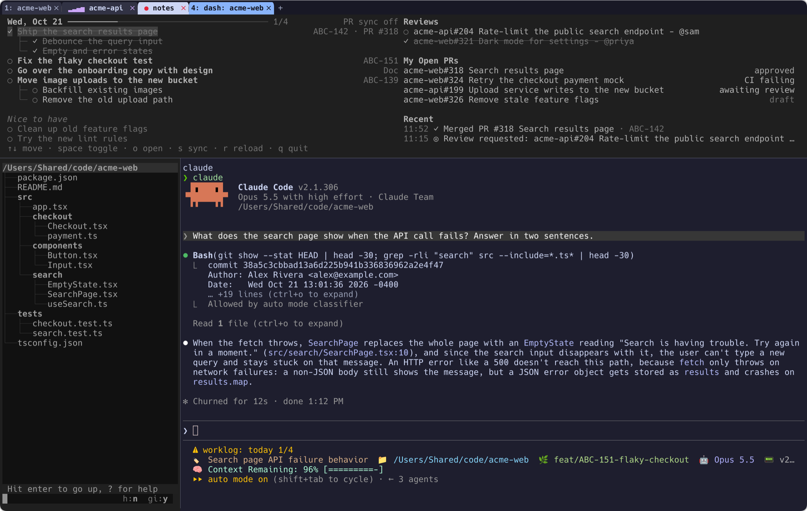
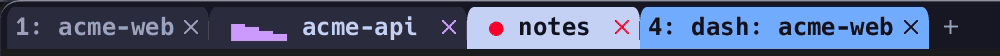
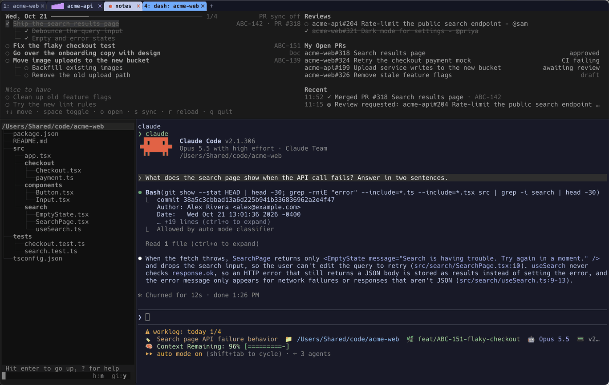
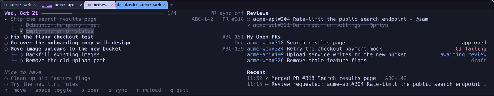

# dotfiles

My terminal setup for Mac and Windows: WezTerm, zsh or PowerShell, and Claude Code, with a work-log dashboard that opens as a WezTerm tab.



Only the focused pane (Claude, here) is in full color; the rest dim, so you can always tell where your keys go.

- **One WezTerm config for both OSes.** Keys sit in the same physical spot on each keyboard (Mac Cmd is Windows Alt), and the layout is saved and restored across restarts.
- **Claude Code in the terminal.** Open a tab running Claude in the current folder with one key. On Mac, background tabs show when Claude is working and when it needs you, and Claude's status line shows the folder, branch, model, context left and today's plan progress.
- **A dashboard tab.** Today's plan, your open PRs and review requests, and recent work-log events sit above a Claude session rooted at the current repo, beside your other Claude sessions.
- **Shell helpers.** A p10k prompt (oh-my-posh on Windows), fuzzy file open and live content search, zoxide, lazygit, delta diffs, and git's GitHub login following gh's active account.

Configs are symlinked into place, so editing one on any machine edits the repo. Fork it first if you want to keep your own changes.

## Install

### Mac

```bash
gh repo clone KyleWelfare/dotfiles ~/dotfiles
brew bundle --file ~/dotfiles/mac/Brewfile
~/dotfiles/mac/install.sh
```

### Windows

Turn on Developer Mode first (Settings > System > For developers), or configs are copied instead of linked.

```powershell
winget install --id Git.Git -e; winget install --id GitHub.cli -e
# open a new shell so git and gh are on PATH
gh auth login
gh repo clone KyleWelfare/dotfiles $HOME\dotfiles
powershell -ExecutionPolicy Bypass -File $HOME\dotfiles\windows\bootstrap.ps1
```

`bootstrap.ps1` installs everything in `windows/winget.txt`, plus bun and Claude Code.

Both scripts move an existing file to `<name>.bak-<timestamp>` before linking over it, and are safe to rerun. Restart WezTerm afterwards.

## Setup questions

The first install asks a few questions, so nothing personal or machine-specific has to live in the repo. The answers go to untracked files:

| File | Holds |
|---|---|
| `~/.config/dotfiles/local.json` | Work log folder, PR sync, ticket links and the review bot |
| `~/.gitconfig.local` | Git `user.name` and `user.email` |
| `~/.ssh/config.local` (Windows) | One SSH host |

Every answer is optional. Enter keeps the value shown in brackets and `-` clears it. Rerun with `mac/install.sh --configure`, `bootstrap.ps1 -Configure` or `bun ~/dotfiles/shared/setup.ts`.

Anything else machine-specific goes in `~/.gitconfig.local` or, on Mac, `~/.zshrc.local`, both loaded last.

## Keybinds

| Action | Mac | Windows |
|---|---|---|
| New tab | Cmd+T | Alt+T |
| Go to tab 1-8 / last tab | Cmd+1-8 / Cmd+9 | Alt+1-8 / Alt+9 |
| Next / previous tab | Ctrl+Tab / Ctrl+Shift+Tab | Ctrl+Tab / Ctrl+Shift+Tab |
| Move tab left / right | Cmd+Shift+Left / Right | Alt+Shift+Left / Right |
| Close tab | Cmd+Shift+W | Alt+Shift+W |
| Split right / below | Cmd+D / Cmd+Shift+D | Alt+D / Alt+Shift+D |
| Close pane | Cmd+W | Alt+W |
| Zoom pane (toggle) | Cmd+Shift+Enter | Alt+Shift+Enter |
| Move between panes | Cmd+Opt+Arrows | Ctrl+Shift+Arrows |
| Resize pane | Cmd+Ctrl+Arrows | Alt+Ctrl+Arrows |
| Move pane into another tab (prompts for a tab index, -1 = last) | Cmd+Ctrl+M | Alt+Ctrl+M |
| New tab running Claude here | Cmd+Shift+T | Alt+Shift+T |
| Start Claude in this pane | Cmd+Shift+C | Alt+Shift+C |
| Dashboard tab | Cmd+Shift+B | Alt+Shift+B |
| Command palette | Cmd+Shift+P | Alt+Shift+P |
| Workspace switcher (Windows: also shells) | Cmd+Shift+S | Alt+Shift+S |
| Save session / restore a saved one | Cmd+Ctrl+S / Cmd+Ctrl+R | Alt+Ctrl+S / Alt+Ctrl+R |
| Re-maximize the window | Cmd+Shift+M | Alt+Shift+M |
| Search scrollback | Cmd+F | Ctrl+Shift+F |
| Clear scrollback | Cmd+K | Ctrl+Shift+K |
| New window | Cmd+N | Ctrl+Shift+N |
| Font size bigger / smaller / reset | Cmd+= / Cmd+- / Cmd+0 | Ctrl+= / Ctrl+- / Ctrl+0 |
| Open a link | Click (Shift+click where an app takes the mouse) | Same |

A zoomed pane gets a pink border and a `PANE ZOOMED` badge, so the panes hidden behind it aren't forgotten. The layout is saved every 15 minutes and whenever WezTerm loses focus, and comes back on launch (running programs don't).

### Claude tab indicators (Mac)



A background tab running Claude shows a moving wave while it works and a red dot when it's waiting on you, with a toast if WezTerm isn't focused. The dot dims once you've looked at the tab.

### Shell

| Command | Does |
|---|---|
| `f` | Fuzzy-pick a file (with a preview) and open it in micro |
| `rgf [regex]` | Live content search; Enter opens the match at its line |
| `z <part of a path>` | Jump to a directory you've been in |
| `lg` | lazygit |
| `gc <message>` | Add everything, commit and push |
| `ghSwitch` (Mac) | Swap gh between two logged-in accounts; git's GitHub login follows |
| `c` (Mac) | `claude` |
| `ai` (Mac) | Pick a Claude or Codex model with fzf and launch it |

## Dashboard

Cmd+Shift+B (Alt+Shift+B on Windows) opens a tab for the current folder: `shared/worklog-dash` across the top, the Claude sessions that match no plan item and the recent log events on the left, and Claude in the rest.

Move between the panes with Cmd+Opt+Arrows (Ctrl+Shift+Arrows on Windows); the focused one is in full color and the rest dim.



With the dashboard focused, up/down or j/k move, space ticks a checkbox, o opens the row's first link, s syncs PRs, r reloads and q quits.



**The work log** is one markdown file per day, at `<log folder>/YYYY/YYYY-MM/YYYY-MM-DD.md`. The dashboard shows four sections and ignores the rest:

```markdown
## Plan
- [ ] Ship search ([ABC-142](https://tracker.example.com/browse/ABC-142))
	- [x] Index the docs
- [ ] Review the onboarding copy

## Nice to have
- [ ] Clean up old feature flags

## Reviews
## My open PRs
```

Tab-indented items nest under the one above. A trailing `(...)` of links shows as refs on the right.

**PR sync** fills in Reviews and My open PRs from gh every 5 minutes. By default it shows your own open PRs and review requests from gh's active account. In setup you can turn it off, pin it to one gh account, limit it to an org, and add an org team whose review requests count as yours. A new review request raises a desktop notification.

**The worklog Claude Code mod** (`shared/claude/mods/worklog`, linked to `~/.claude/mods/worklog`) adds events to the log as you work in Claude: commits, opened and merged PRs, a one-line summary of each session, and Jira moves when the Atlassian connector is set up. It also shows today's plan progress in Claude's status line. Events land in `<log folder>/.events/YYYY-MM-DD.jsonl`, and the dashboard lists the latest under Recent.

**Two Claude skills** go with it, linked into `~/.claude/skills`: `/sessions` reports every live Claude session (state, ticket, context left), and its script also feeds the dashboard's session marks; `/sync-day` does the judgement half of keeping the log current (ticks a ticket or an event settles, Jira moves, flags), while the dashboard's sync does the mechanical half. Both read their per-machine values from `local.json`.

**Ticket links** are off unless you give a URL with `{id}` in it, such as `https://tracker.example.com/browse/{id}`. With one set, ticket IDs in branch names, commits and PR titles are recorded on events and linked in the dashboard. IDs default to uppercase keys like `ABC-123`; you can give your own regex.

## Repo layout

```
shared/    every OS: wezterm.lua, gitconfig, git-ignore, ssh-config, setup.ts,
           claude/statusline.sh, claude/mods/worklog, claude/skills, worklog-dash
mac/       zshrc, p10k theme, Brewfile, Claude wezterm-flag hook, install.sh
windows/   PowerShell profile, oh-my-posh theme, winget list, bootstrap.ps1
```

## License

MIT
